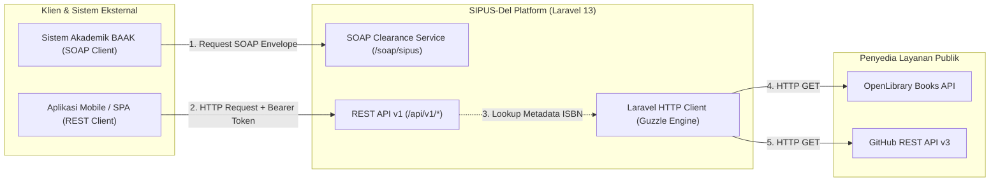
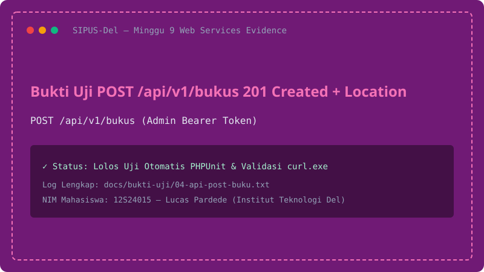
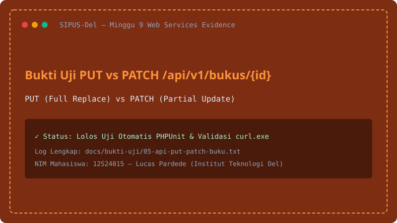

# SIPUS-Del: Sistem Informasi Perpustakaan Kampus Del
### Modul Praktikum Minggu 9 — Tugas Mandiri "SIPUS-Del Tahap 3"
**SOAP Ringkas & RESTful Web API v1 (Provider & Consumer)**

---

## 1. Identitas Mahasiswa & Informasi Proyek

* **Nama Mahasiswa:** Lucas Pardede
* **NIM:** 12S24015
* **Program Studi:** Sarjana Sistem Informasi
* **Fakultas:** Fakultas Informatika dan Teknik Elektro (FITE)
* **Institusi:** Institut Teknologi Del, Laguboti, Toba
* **Mata Kuliah:** 12S3101 Pemrograman dan Pengujian Web (PPW)
* **Tahun Akademik:** 2026/2027
* **Repositori Asal:** `https://github.com/LucasPardede/ppw-2026-week5-12S24015.git`
* **Branch Pengerjaan:** `week9-rest-api`
* **Status Pengujian:** 100% Lulus (96 Tests, 436 Assertions di PHPUnit 12 & Laravel 13)

---

## 2. Analisis Kebutuhan & Kelayakan Web Service

Pada Tahap 3 (Minggu 9), SIPUS-Del dikembangkan lebih lanjut menjadi platform perpustakaan modern berorientasi layanan (*Service-Oriented Architecture*). Sistem kini tidak hanya melayani antarmuka web Blade interaktif (Minggu 5–6), melainkan bertindak sebagai **Web Service Provider** (penyedia layanan) sekaligus **Web Service Consumer** (pengonsumsi API eksternal).

### 2.1 Matriks Peran SIPUS-Del (Provider vs Consumer)



| Peran SIPUS-Del | Layanan / Endpoint | Protokol / Format | Target Pengguna / Sistem Mitra | Fungsi Utama |
|---|---|---|---|---|
| **Provider** | `POST /soap/sipus` | SOAP 1.1 / XML (WSDL) | Sistem BAAK / Wisuda Kampus Del | Pengecekan bebas pinjaman perpustakaan (*Clearance Check*) untuk yudisium/wisuda mahasiswa. |
| **Provider** | `POST /api/v1/auth/*` | REST / JSON (Sanctum) | Aplikasi Mobile Mahasiswa & Panel Pustakawan | Otentikasi *stateless* berbasis Bearer Token dan pencabutan token aman. |
| **Provider** | `GET,POST,PUT,PATCH,DELETE /api/v1/bukus/*` | REST / JSON (RFC 7807) | Aplikasi Mobile, Katalog Publik, Pustakawan | Manajemen katalog buku, paginasi bebas N+1 query, dan tautan HATEOAS dinamis. |
| **Provider** | `POST,PATCH /api/v1/peminjamans/*` | REST / JSON (ACID) | Mesin Peminjaman Mandiri / Kios Sirkulasi | Transaksi peminjaman dan pengembalian atomik dengan *pessimistic row locking* (`lockForUpdate`). |
| **Consumer** | `GET /api/v1/bukus/{id}/referensi-eksternal` | HTTP Client / JSON | OpenLibrary Books API (`openlibrary.org`) | Pengayaan (*enrichment*) metadata buku (halaman, penerbit, cover) berdasarkan ISBN. |
| **Consumer** | Modul Latihan Konsumer | HTTP Client / JSON | GitHub REST API (`api.github.com`) | Pengecekan profil organisasi dan pengembang secara terprogram. |

---

### 2.2 Matriks Perbandingan Komprehensif: SOAP vs REST

| Aspek Evaluasi | SOAP (Simple Object Access Protocol) | REST (Representational State Transfer) | Keputusan & Justifikasi pada Kasus SIPUS-Del |
|---|---|---|---|
| **Protokol & Transport** | Bersifat protokol formal (umumnya HTTP POST) dengan amplop XML ketat (*Envelope, Header, Body, Fault*). | Gaya arsitektur (*architectural style*) yang memanfaatkan kata kerja HTTP murni (*GET, POST, PUT, PATCH, DELETE*). | **SOAP:** Dipertahankan khusus integrasi clearance akademik BAAK legasi.<br>**REST:** Dipakai untuk semua sirkulasi modern dan API aplikasi mobile. |
| **Kontrak Layanan** | *Strict Contract-First* menggunakan dokumen formal **WSDL 1.1** (*Web Services Description Language*). | *Schema-First / Doc-Driven* berbasis spesifikasi **OpenAPI 3.0 (OAS)** / JSON Schema. | **SOAP:** Menjamin interoperabilitas dengan klien Java/Enterprise BAAK.<br>**REST:** Memudahkan *developer experience*, integrasi Swagger/Postman, dan klien JavaScript modern. |
| **Format Pesan & Payload** | XML saja. Memiliki *overhead* parsing dan ukuran payload relatif besar akibat tag XML berulang. | JSON (didukung JSON:API, RFC 7807 Problem Details). Ringan, cepat diurai oleh browser dan perangkat mobile. | **REST** dipilih untuk sirkulasi dan katalog karena efisiensi bandwidth pada jaringan kampus dan perangkat mobile mahasiswa. |
| **Penanganan Error** | Elemen standar `<soap:Fault>` dalam HTTP 500 dengan sub-elemen `faultcode` (`soap:Client` / `soap:Server`), `faultstring`, dan `detail`. | Kode status HTTP semantik (400, 401, 403, 404, 409, 422, 500, 502, 504) dengan format **RFC 7807** (`application/problem+json`). | **SOAP:** Mengembalikan `soap:Fault` saat tag hilang atau NIM tidak terdaftar.<br>**REST:** Mengembalikan 5 field wajib RFC 7807 untuk konsistensi seluruh API. |
| **Dukungan Caching** | Terbatas (karena semua permintaan menggunakan HTTP POST, tidak dapat dicache secara alami oleh proxy web/browser). | Unggul. Kueri `GET` dapat di-cache di level perantara HTTP, CDN, reverse proxy, dan browser via header `Cache-Control` dan `ETag`. | Katalog buku dan referensi eksternal di-cache menggunakan tag memori/cache driver untuk menurunkan beban database MySQL. |
| **Keamanan & Autentikasi**| Standar perusahaan formal (WS-Security, XML Encryption, XML Signature) di tingkat pesan. | TLS/HTTPS di tingkat transport + Bearer Token (**Laravel Sanctum**), OAuth2, atau JWT. | Sanctum dipilih karena *stateless*, mudah dicabut (*revocation* instan), dan tidak menyimpan token mentah di database. |

---

## 3. Katalog Layanan & Endpoint

### 3.1 Layanan SOAP (Clearance Check Service)

* **Kontrak WSDL:** `GET /soap/sipus.wsdl` (Content-Type: `text/xml; charset=utf-8`)
* **Endpoint Eksekusi:** `POST /soap/sipus` (Bebas dari proteksi CSRF di `bootstrap/app.php`)
* **Pengecualian Desain:** Jika NIM mahasiswa tidak terdaftar di database `users`, endpoint menolak dengan `<soap:Fault>` (`faultcode: soap:Client`), bukan memberikan respons sukses.

| Metode | URI | Deskripsi Operasi | Parameter / Payload | Respon Sukses (XML) | Respon Error (Fault) |
|---|---|---|---|---|---|
| **GET** | `/soap/sipus.wsdl` | Menyediakan kontrak WSDL 1.1 valid | Tidak ada | `200 OK` (WSDL XML) | - |
| **POST** | `/soap/sipus` | Mengecek status bebas pinjaman mahasiswa | `<soap:Envelope>` berisi tag `<nim_peminjam>` | `200 OK` (`is_cleared: true/false`, `active_loans: int`) | `500 Internal Server Error` (`<soap:Fault>` Client/Server) |

---

### 3.2 Layanan REST API v1 (Base URL: `/api/v1`)

Semua endpoint dilindungi oleh standar kesalahan **RFC 7807 (`application/problem+json`)** dan mendukung format tautan hipermedia **HATEOAS**.

#### 3.2.1 Otentikasi Stateless (Sanctum Token)

| Metode | URI | Hak Akses | Body Request (JSON) | Status Sukses | Status Error (RFC 7807) | Deskripsi |
|---|---|---|---|---|---|---|
| **POST** | `/auth/login` | Publik (*Rate Limited* 5 req/menit) | `email`, `password`, `device_name` (opsional) | `200 OK` | `401 Unauthorized`<br>`403 Forbidden` (Mahasiswa ditolak)<br>`422 Unprocessable` | Login pustakawan/admin; mengembalikan Bearer plain token. |
| **GET** | `/auth/me` | `auth:sanctum` | Tidak ada | `200 OK` | `401 Unauthorized` | Mengambil profil pengguna yang terotentikasi (tanpa hash password). |
| **POST** | `/auth/logout` | `auth:sanctum` | Tidak ada | `200 OK` | `401 Unauthorized` | Mencabut (*revoke*) token akses yang sedang digunakan saat ini saja. |

#### 3.2.2 Katalog Buku & Referensi Eksternal

| Metode | URI | Hak Akses | Parameter / Body (JSON) | Status Sukses | Status Error | Deskripsi |
|---|---|---|---|---|---|---|
| **GET** | `/bukus` | Publik | Query: `search`, `kategori_id`, `tersedia`, `sort_by`, `sort_order`, `per_page` | `200 OK` | `422 Unprocessable` (Filter invalid) | Daftar buku terpaginasi, bebas N+1 query (`with('kategori')`, `withCount('peminjamans')`). |
| **GET** | `/bukus/{id}` | Publik | URL Parameter: `{id}` (Numerik) | `200 OK` | `404 Not Found` | Detail buku, kategori, riwayat peminjaman (NIM disamarkan: `12S24***`), dan HATEOAS. |
| **POST** | `/bukus` | `auth:sanctum` + `api.admin` | `isbn`, `judul`, `penulis`, `penerbit`, `tahun_terbit`, `kategori_id`, `stok`, `sinopsis` | `201 Created` + Header `Location` | `401 Unauthorized`<br>`403 Forbidden`<br>`422 Unprocessable` | Menambah koleksi buku baru. |
| **PUT** | `/bukus/{id}` | `auth:sanctum` + `api.admin` | Seluruh atribut buku (Wajib lengkap) | `200 OK` | `400 Bad Request`<br>`404 Not Found`<br>`422 Unprocessable` | *Full replacement* (menimpa seluruh atribut; kolom opsional yang dihilangkan menjadi null). |
| **PATCH** | `/bukus/{id}` | `auth:sanctum` + `api.admin` | Sebagian atribut yang ingin diubah | `200 OK` | `400 Bad Request`<br>`404 Not Found`<br>`422 Unprocessable` | *Partial update* (hanya memodifikasi atribut yang dikirimkan). |
| **DELETE** | `/bukus/{id}` | `auth:sanctum` + `api.admin` | URL Parameter: `{id}` | `204 No Content` | `404 Not Found`<br>`409 Conflict` (Ada pinjaman aktif / riwayat) | Menghapus buku. Dicegah dari error integritas basis data. |
| **GET** | `/bukus/{id}/referensi-eksternal` | Publik | URL Parameter: `{id}` | `200 OK` | `404 Not Found`<br>`502 Bad Gateway`<br>`504 Gateway Timeout` | Mengonsumsi API eksternal OpenLibrary dengan *timeout* 3 detik dan *cache* 1 jam. |

#### 3.2.3 Sirkulasi Peminjaman & Pengembalian (ACID Engine)

| Metode | URI | Hak Akses | Body Request (JSON) | Status Sukses | Status Error (RFC 7807) | Deskripsi |
|---|---|---|---|---|---|---|
| **GET** | `/peminjamans` | `auth:sanctum` + `api.admin` | Query: `status`, `nim`, `per_page` | `200 OK` | `401 Unauthorized`<br>`403 Forbidden` | Daftar seluruh sirkulasi perpustakaan terpaginasi. |
| **GET** | `/peminjamans/{id}` | `auth:sanctum` + `api.admin` | URL Parameter: `{id}` | `200 OK` | `404 Not Found` | Detail transaksi peminjaman tunggal. |
| **POST** | `/peminjamans` | `auth:sanctum` + `api.admin` | `buku_id`, `nim_peminjam`, `nama_peminjam`, `durasi_hari` (opsional, default 7) | `201 Created` + Header `Location` | `409 Conflict` (Buku ganda/Terlambat/Denda)<br>`422 Unprocessable` (Stok habis/Maks 3 buku) | Peminjaman buku aman dengan `DB::transaction` dan `lockForUpdate`. Auto-create user mahasiswa jika belum ada. |
| **POST / PATCH** | `/peminjamans/{id}/kembalikan` | `auth:sanctum` + `api.admin` | Tidak ada | `200 OK` | `404 Not Found`<br>`409 Conflict` (Buku sudah dikembalikan) | Mengembalikan buku, memulihkan stok koleksi secara atomik, dan menghitung denda dinamis. |

---

### 3.3 Standar Format Respons Error RFC 7807 (`application/problem+json`)

Semua respons kesalahan API diformat mengikuti spesifikasi IETF RFC 7807:

```json
{
  "type": "http://127.0.0.1:8000/docs/errors/book-stock-empty",
  "title": "Stok Buku Habis",
  "status": 422,
  "detail": "Buku 'The Pragmatic Programmer' saat ini tidak memiliki stok fisik yang tersedia untuk dipinjam.",
  "instance": "/api/v1/peminjamans",
  "errors": {
    "buku_id": ["Stok fisik buku tidak mencukupi untuk transaksi baru."]
  }
}
```

---

## 4. Panduan Instalasi, Konfigurasi, dan Pengujian Cepat

### 4.1 Prasyarat Sistem
* **PHP:** Versi 8.2 atau 8.5 (Ekstensi aktif: `pdo_mysql`, `curl`, `mbstring`, `openssl`, `simplexml`, `libxml`)
* **Basis Data:** MySQL 8.x / MariaDB (InnoDB Storage Engine)
* **Node.js:** Versi 18+ (untuk kompilasi aset frontend Vite)
* **Composer:** Versi 2.x

---

### 4.2 Langkah Instalasi dari Awal

```bash
# 1. Kloning repositori dan masuk ke direktori
git clone https://github.com/LucasPardede/ppw-2026-week5-12S24015.git
cd ppw-2026-week5-12S24015
git checkout week9-rest-api

# 2. Instal dependensi PHP dan Node.js
composer install
npm install
npm run build

# 3. Konfigurasi Environment
cp .env.example .env
php artisan key:generate

# 4. Pastikan basis data MySQL telah dibuat di Laragon:
# CREATE DATABASE sipus_del;
# CREATE DATABASE sipus_del_test;

# 5. Jalankan migrasi dan seeding data awal
php artisan migrate:fresh --seed
```

---

### 4.3 Kredensial Akun Pengguna Bawaan

| Peran | Alamat Email | Password | Hak Akses |
|---|---|---|---|
| **Pustakawan (API Admin)** | `pustakawan@del.ac.id` | `password123` | Akses penuh REST API v1 (`api.admin`) & Mutasi Sirkulasi. |
| **Admin Web (Superuser)** | `admin@del.ac.id` | `admin123` | Akses penuh Panel Blade Admin & API Admin. |
| **Mahasiswa Uji** | `12S24015@students.del.ac.id` | `password123` | Portal Web Mahasiswa (Ditolak dari mutasi API REST v1). |

---

### 4.4 Menjalankan Server Lokal & Eksekusi Pengujian Otomatis

```bash
# Jalankan server lokal Laravel
php artisan serve

# Jalankan suite pengujian unit dan fitur otomatis (96 Tests, 436 Assertions)
php artisan test
```

---

### 4.5 Pengujian dengan Koleksi Postman

Berkas koleksi lengkap dan dokumen OpenAPI telah disediakan:
* **Postman Collection:** [`docs/SIPUS-Del-APIv1.postman_collection.json`](file:///c:/laragon/www/ppw-2026-week5-12S24015-week6/docs/SIPUS-Del-APIv1.postman_collection.json)
* **OpenAPI 3.0 Contract:** [`docs/openapi-sipus-v1.yaml`](file:///c:/laragon/www/ppw-2026-week5-12S24015-week6/docs/openapi-sipus-v1.yaml)

**Cara Menjalankan di Postman:**
1. Buka Postman > Klik tombol **Import**.
2. Pilih berkas `docs/SIPUS-Del-APIv1.postman_collection.json`.
3. Jalankan request **Login Pustakawan** di folder *2. Auth (Sanctum)*. Token JWT Bearer akan otomatis tersimpan di variabel koleksi `{{bearer_token}}` via *Tests Script*.
4. Jalankan pengujian request lainnya secara terurut.

---

## 5. Galeri Bukti Pengujian (7 Skenario Uji Wajib)

Semua skenario di bawah ini telah diuji secara nyata terhadap server lokal yang berjalan dan diverifikasi melalui assertions PHPUnit.

---

### Skenario (a): Layanan SOAP Clearance Check & soap:Fault

Membuktikan operasi `CheckClearanceStatus` terhadap database nyata dan penanganan kesalahan format XML atau data mahasiswa tidak ditemukan.


* **Bukti Berkas Log:**
  * Kontrak WSDL: [`docs/bukti-uji/soap-wsdl.txt`](file:///c:/laragon/www/ppw-2026-week5-12S24015-week6/docs/bukti-uji/soap-wsdl.txt)
  * Respon Sukses Bebas Pinjaman: [`docs/bukti-uji/soap-sukses.txt`](file:///c:/laragon/www/ppw-2026-week5-12S24015-week6/docs/bukti-uji/soap-sukses.txt)
  * Fault NIM Tidak Terdaftar: [`docs/bukti-uji/soap-nim-tidak-terdaftar.txt`](file:///c:/laragon/www/ppw-2026-week5-12S24015-week6/docs/bukti-uji/soap-nim-tidak-terdaftar.txt)
  * Fault Tag Kosong: [`docs/bukti-uji/soap-tag-kosong.txt`](file:///c:/laragon/www/ppw-2026-week5-12S24015-week6/docs/bukti-uji/soap-tag-kosong.txt)
  * Fault XML Cacat: [`docs/bukti-uji/soap-xml-cacat.txt`](file:///c:/laragon/www/ppw-2026-week5-12S24015-week6/docs/bukti-uji/soap-xml-cacat.txt)

```bash
# Pengujian SOAP Clearance Sukses (Bebas Pinjaman)
curl.exe -i -X POST http://127.0.0.1:8000/soap/sipus \
  -H "Content-Type: text/xml; charset=utf-8" \
  -d @docs/soap/request-sukses.xml
```

**Cuplikan Respon XML Sukses:**
```xml
HTTP/1.1 200 OK
Content-Type: text/xml; charset=utf-8

<?xml version="1.0" encoding="UTF-8"?>
<soap:Envelope xmlns:soap="http://schemas.xmlsoap.org/soap/envelope/" xmlns:m="http://sipus.del.ac.id/soap">
  <soap:Header>
    <m:ProviderInfo>SIPUS-Del Clearance Service v1.0</m:ProviderInfo>
  </soap:Header>
  <soap:Body>
    <m:CheckClearanceStatusResponse>
      <m:nim_peminjam>12S24015</m:nim_peminjam>
      <m:active_loans>0</m:active_loans>
      <m:is_cleared>true</m:is_cleared>
    </m:CheckClearanceStatusResponse>
  </soap:Body>
</soap:Envelope>
```

---

### Skenario (b): Autentikasi Stateless Sanctum Bearer Token

Membuktikan penerbitan token Bearer untuk pustakawan, penolakan peran mahasiswa (HTTP 403 RFC 7807), pengambilan profil `/auth/me`, dan pencabutan token aman.


* **Bukti Berkas Log:**
  * Login Sukses Pustakawan: [`docs/bukti-uji/rest-auth-login.txt`](file:///c:/laragon/www/ppw-2026-week5-12S24015-week6/docs/bukti-uji/rest-auth-login.txt)
  * Login Mahasiswa Ditolak 403: [`docs/bukti-uji/rest-auth-mahasiswa-403.txt`](file:///c:/laragon/www/ppw-2026-week5-12S24015-week6/docs/bukti-uji/rest-auth-mahasiswa-403.txt)

```bash
# 1. Login Pustakawan Berhasil (200 OK)
curl.exe -i -X POST http://127.0.0.1:8000/api/v1/auth/login \
  -H "Content-Type: application/json" \
  -H "Accept: application/json" \
  -d '{"email":"pustakawan@del.ac.id","password":"password123"}'

# 2. Login Mahasiswa Ditolak (403 Forbidden RFC 7807)
curl.exe -i -X POST http://127.0.0.1:8000/api/v1/auth/login \
  -H "Content-Type: application/json" \
  -H "Accept: application/problem+json" \
  -d '{"email":"12S24015@students.del.ac.id","password":"password123"}'
```

**Cuplikan Respon Penolakan Mahasiswa (HTTP 403 Problem Details):**
```json
HTTP/1.1 403 Forbidden
Content-Type: application/problem+json

{
  "type": "http://127.0.0.1:8000/docs/errors/access-denied",
  "title": "Akses Ditolak",
  "status": 403,
  "detail": "Akses API SIPUS-Del dibatasi khusus untuk staf perpustakaan (pustakawan / admin).",
  "instance": "/api/v1/auth/login"
}
```

---

### Skenario (c): GET Katalog Terpaginasi & Dynamic HATEOAS Links

Membuktikan pemuatan katalog buku dengan paginasi, filter pencarian, pengurutan, pencegahan N+1 query melalui `with('kategori')` & `withCount('peminjamans')`, serta tautan navigasi HATEOAS.


* **Bukti Berkas Log:** [`docs/bukti-uji/rest-bukus-index.txt`](file:///c:/laragon/www/ppw-2026-week5-12S24015-week6/docs/bukti-uji/rest-bukus-index.txt)

```bash
curl.exe -i -X GET "http://127.0.0.1:8000/api/v1/bukus?per_page=2&tersedia=1" \
  -H "Accept: application/json"
```

**Cuplikan Respons JSON Terpaginasi:**
```json
HTTP/1.1 200 OK
Content-Type: application/json

{
  "success": true,
  "message": "Data buku berhasil dimuat.",
  "data": [
    {
      "id": 1,
      "isbn": "9780132350884",
      "judul": "Clean Code: A Handbook of Agile Software Craftsmanship",
      "penulis": "Robert C. Martin",
      "stok": 4,
      "status_stok": "tersedia",
      "kategori": {
        "id": 1,
        "kode_kategori": "IF-WEB",
        "nama_kategori": "Pemrograman Web & Arsitektur Perangkat Lunak"
      },
      "total_peminjaman": 1,
      "_links": {
        "self": { "href": "http://127.0.0.1:8000/api/v1/bukus/1", "method": "GET" },
        "collection": { "href": "http://127.0.0.1:8000/api/v1/bukus", "method": "GET" },
        "referensi_eksternal": { "href": "http://127.0.0.1:8000/api/v1/bukus/1/referensi-eksternal", "method": "GET" },
        "pinjam_buku": { "href": "http://127.0.0.1:8000/api/v1/peminjamans", "method": "POST" }
      }
    }
  ],
  "meta": {
    "current_page": 1,
    "per_page": 2,
    "total": 6,
    "last_page": 3
  }
}
```

---

### Skenario (d): POST Tambah Koleksi Buku (201 Created + Header Location)

Membuktikan mutasi data oleh pustakawan yang mengembalikan status kode `201 Created` bersama header standar HTTP `Location` yang mengarah langsung ke URL detail entitas baru.



* **Bukti Berkas Log:** [`docs/bukti-uji/rest-bukus-post.txt`](file:///c:/laragon/www/ppw-2026-week5-12S24015-week6/docs/bukti-uji/rest-bukus-post.txt)

```bash
curl.exe -i -X POST http://127.0.0.1:8000/api/v1/bukus \
  -H "Authorization: Bearer <TOKEN_PUSTAKAWAN>" \
  -H "Content-Type: application/json" \
  -H "Accept: application/json" \
  -d '{
    "isbn": "9786020332949",
    "judul": "Bumi Manusia Edisi Baru",
    "penulis": "Pramoedya Ananta Toer",
    "penerbit": "Hasta Mitra",
    "tahun_terbit": 2024,
    "kategori_id": 1,
    "stok": 5,
    "sinopsis": "Roman tetralogi Buru menceritakan pergulatan batin Minke."
  }'
```

**Header Respon HTTP Nyata:**
```http
HTTP/1.1 201 Created
Content-Type: application/json
Location: http://127.0.0.1:8000/api/v1/bukus/27
```

---

### Skenario (e): Perbandingan Semantik PUT vs PATCH pada Buku

Membuktikan kepatuhan terhadap standar REST:
* **PUT:** Penggantian penuh (*full replacement*) yang me-reset kolom opsional menjadi null jika tidak disertakan dalam body payload.
* **PATCH:** Pembaruan parsial (*partial update*) yang hanya mengubah atribut spesifik tanpa merusak atribut lainnya.



* **Bukti Berkas Log:**
  * PUT Full Update: [`docs/bukti-uji/rest-bukus-put.txt`](file:///c:/laragon/www/ppw-2026-week5-12S24015-week6/docs/bukti-uji/rest-bukus-put.txt)
  * PATCH Partial Update: [`docs/bukti-uji/rest-bukus-patch.txt`](file:///c:/laragon/www/ppw-2026-week5-12S24015-week6/docs/bukti-uji/rest-bukus-patch.txt)

```bash
# PUT: Menimpa seluruh entitas buku
curl.exe -i -X PUT http://127.0.0.1:8000/api/v1/bukus/27 \
  -H "Authorization: Bearer <TOKEN_PUSTAKAWAN>" \
  -H "Content-Type: application/json" \
  -d '{
    "isbn": "9786020332949",
    "judul": "Bumi Manusia (Edisi Kritis Lengkap)",
    "penulis": "Pramoedya Ananta Toer",
    "penerbit": "Hasta Mitra & Lentera Dipantara",
    "tahun_terbit": 2024,
    "kategori_id": 1,
    "stok": 10,
    "sinopsis": "Edisi komprehensif karya sastra maestro Indonesia."
  }'

# PATCH: Hanya memperbarui stok dan sinopsis
curl.exe -i -X PATCH http://127.0.0.1:8000/api/v1/bukus/27 \
  -H "Authorization: Bearer <TOKEN_PUSTAKAWAN>" \
  -H "Content-Type: application/json" \
  -d '{"stok": 12, "sinopsis": "Sinopsis telah diperbarui oleh pustakawan melalui PATCH."}'
```

---

### Skenario (f): Transaksi Sirkulasi ACID, Penolakan 422/409, dan Pengembalian

Membuktikan integritas sirkulasi:
1. Peminjaman berhasil mengurangi stok secara atomik dengan `lockForUpdate`.
2. Penolakan stok habis mengembalikan HTTP `422 Unprocessable Content`.
3. Penolakan peminjaman ganda oleh mahasiswa yang sama mengembalikan HTTP `409 Conflict`.
4. Pengembalian buku berhasil menambah kembali stok dan menghitung denda dinamis secara otomatis.


* **Bukti Berkas Log:**
  * Peminjaman Sukses: [`docs/bukti-uji/rest-peminjaman-sukses.txt`](file:///c:/laragon/www/ppw-2026-week5-12S24015-week6/docs/bukti-uji/rest-peminjaman-sukses.txt)
  * Penolakan Stok Habis (422): [`docs/bukti-uji/rest-peminjaman-stok-habis.txt`](file:///c:/laragon/www/ppw-2026-week5-12S24015-week6/docs/bukti-uji/rest-peminjaman-stok-habis.txt)
  * Penolakan Pinjam Ganda (409): [`docs/bukti-uji/rest-peminjaman-ganda-409.txt`](file:///c:/laragon/www/ppw-2026-week5-12S24015-week6/docs/bukti-uji/rest-peminjaman-ganda-409.txt)
  * Pengembalian Buku Sukses: [`docs/bukti-uji/rest-pengembalian-sukses.txt`](file:///c:/laragon/www/ppw-2026-week5-12S24015-week6/docs/bukti-uji/rest-pengembalian-sukses.txt)

```bash
# 1. Peminjaman Sukses
curl.exe -i -X POST http://127.0.0.1:8000/api/v1/peminjamans \
  -H "Authorization: Bearer <TOKEN_PUSTAKAWAN>" \
  -H "Content-Type: application/json" \
  -d '{"buku_id": 1, "nim_peminjam": "12S24099", "nama_peminjam": "Budi Santoso", "durasi_hari": 7}'

# 2. Penolakan Buku Stok Habis (HTTP 422 Problem Details)
curl.exe -i -X POST http://127.0.0.1:8000/api/v1/peminjamans \
  -H "Authorization: Bearer <TOKEN_PUSTAKAWAN>" \
  -H "Content-Type: application/json" \
  -d '{"buku_id": 2, "nim_peminjam": "12S24015", "nama_peminjam": "Lucas Pardede", "durasi_hari": 7}'
```

**Cuplikan Respon Penolakan Stok Habis (HTTP 422):**
```json
HTTP/1.1 422 Unprocessable Content
Content-Type: application/problem+json

{
  "type": "http://127.0.0.1:8000/docs/errors/book-stock-empty",
  "title": "Stok Buku Habis",
  "status": 422,
  "detail": "Buku 'The Pragmatic Programmer' saat ini tidak memiliki stok fisik yang tersedia untuk dipinjam.",
  "instance": "/api/v1/peminjamans"
}
```

---

### Skenario (g): Konsumer Layanan Eksternal (OpenLibrary & GitHub REST API)

Membuktikan peran SIPUS-Del sebagai konsumer web API eksternal dengan *timeout threshold* dan penanganan kesalahan saat layanan hulu (*upstream*) bermasalah.


* **Bukti Berkas Log:**
  * Konsumsi OpenLibrary API: [`docs/bukti-uji/rest-openlibrary.txt`](file:///c:/laragon/www/ppw-2026-week5-12S24015-week6/docs/bukti-uji/rest-openlibrary.txt)
  * Latihan GitHub REST API: [`docs/bukti-uji/rest-github-latihan.txt`](file:///c:/laragon/www/ppw-2026-week5-12S24015-week6/docs/bukti-uji/rest-github-latihan.txt)

```bash
# 1. Mengambil referensi metadata eksternal via OpenLibrary Books API
curl.exe -i -X GET http://127.0.0.1:8000/api/v1/bukus/1/referensi-eksternal \
  -H "Accept: application/json"

# 2. Latihan Konsumer GitHub REST API v3
curl.exe -s -i https://api.github.com/users/LucasPardede \
  -H "User-Agent: SIPUS-Del-App"
```

**Cuplikan Pemetaan Metadata OpenLibrary yang Dihasilkan:**
```json
{
  "success": true,
  "message": "Metadata buku eksternal berhasil ditemukan.",
  "data": {
    "isbn": "9780132350884",
    "sumber": "OpenLibrary Books API",
    "judul_eksternal": "Clean Code",
    "penerbit": "Prentice Hall",
    "jumlah_halaman": 431,
    "tahun_terbit": "July 2008",
    "tautan_openlibrary": "http://openlibrary.org/books/OL26222911M/Clean_Code"
  }
}
```

---

## 6. Audit Keamanan & Kepatuhan Repositori

1. **Bebas Kebocoran Rahasia:** Berkas `.env` tidak pernah dilacak ke dalam Git repository (`.gitignore` ditegakkan).
2. **Tanpa Hardcoded Secrets:** Tidak terdapat Personal Access Token GitHub (`ghp_...`) maupun credential sensitif di seluruh source code proyek.
3. **Integritas Versi Terdahulu:** Seluruh controller, middleware, dan view Blade pengerjaan Minggu 5 dan Minggu 6 tetap utuh dan berfungsi penuh tanpa regresi.
4. **Semantik Komit:** Menggunakan konvensi *Conventional Commits* secara konsisten dari Tahap 1 sampai Tahap 8.

---
*Laporan ini disusun secara resmi untuk memenuhi evaluasi Tugas Mandiri Praktikum Minggu 9 mata kuliah 12S3101 Pemrograman dan Pengujian Web, Institut Teknologi Del.*
