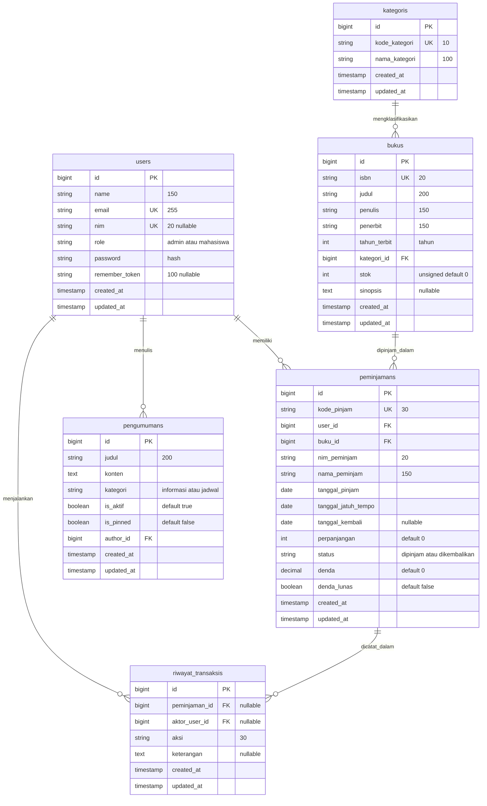

# SIPUS-Del: Sistem Informasi Perpustakaan Kampus Del
### Modul Praktikum Minggu 6 — Tugas Mandiri "SIPUS-Del Tahap 2"
**Mata Kuliah:** 12S3101 Pemrograman dan Pengujian Web  
**Penyusun:** Lucas Pardede (NIM: 12S24015)  
**Institusi:** Institut Teknologi Del, Laguboti, Toba  
**Repositori:** `ppw-2026-week5-12S24015`  
**Branch:** `week6-db-session`

---

## 1. Judul, Deskripsi Sistem, dan Fitur Utama

**SIPUS-Del** adalah aplikasi web sistem informasi perpustakaan digital Institut Teknologi Del yang dirancang untuk mendukung operasional sirkulasi koleksi pustaka, pencegahan inkonsistensi data multi-pengguna (*race condition*), serta keamanan sesi dan autentikasi terisolasi per peran pengguna (*Role-Based Access Control*).

Pada Tahap 2 (Minggu 6), SIPUS-Del ditingkatkan dari prototipe berbasis SQLite menjadi sistem perpustakaan kelas produksi (*enterprise-ready*) berbasis MySQL InnoDB dengan garansi integritas **ACID (Atomicity, Consistency, Isolation, Durability)**, penanganan konkurensi dengan penguncian baris (*pessimistic row locking* `lockForUpdate`), arsitektur layanan terpisah (`PeminjamanService`, `StatistikService`), dan mekanisme keamanan sesi & cookie.

### Fitur Unggulan Sistem:
1. **Transaksi ACID & Pessimistic Row Locking (`lockForUpdate`):**
   - Transaksi peminjaman dan pengembalian dibungkus dalam `DB::transaction(..., 3)`.
   - Mengunci baris buku dan peminjaman secara selektif untuk mencegah anomali *Lost Update* dan penjualan/peminjaman berlebih (*overselling*).
   - Pengurutan kunci deterministik (kunci tabel `bukus` sebelum `peminjamans`) untuk mengeliminasi potensi *deadlock*.
2. **Skema Relasional & Constraint Konsistensi:**
   - Kolom `kode_pinjam` acak unik 30 karakter berformat `PJM-YYYYMMDD-XXXXXX`.
   - Kolom `tanggal_jatuh_tempo` (menggantikan nama lama `jatuh_tempo`).
   - Foreign key `buku_id` dengan aturan `ON DELETE CASCADE`.
   - Indeks komposit `peminjamans_nim_status_idx` dan `peminjamans_buku_nim_status_idx` untuk kecepatan kueri sirkulasi.
   - Kolom `stok` pada tabel `bukus` berjenis `unsignedInteger` default `0`, sehingga basis data di level engine MySQL menolak angka minus.
3. **Audit Trail Mutasi (Tabel `riwayat_transaksis`):**
   - Mencatat otomatis setiap transaksi sukses (`pinjam`, `kembali`, `perpanjang`, `lunas`) bersama aktor, kode referensi, dan timestamp di dalam transaksi yang sama.
4. **Analitik Sirkulasi Koleksi (DB::table Query Builder):**
   - 4 kartu statistik performa tinggi bebas N+1: *Total Judul Buku*, *Total Stok Tersedia* (`sum('stok')`), *Total Buku Sedang Dipinjam*, *Total Dikembalikan*.
   - Analitik Buku Terpopuler via query builder `DB::table()` dengan `join`, `groupBy`, dan agregasi `COUNT`.
5. **State Management Sesi & Cookie Aman:**
   - Regenerasi ID sesi (`session()->regenerate()`) saat login untuk menolak *Session Fixation*.
   - Cookie `del_last_user_email` bertanda `HttpOnly=true` dan `SameSite=Lax` untuk mengisi otomatis email di login form.
   - Session state pencarian terakhir (`last_search`) dengan panel pencarian cepat di katalog.
   - Session state waktu masuk (`login_timestamp`) yang tampil di navbar mahasiswa dan admin.
   - Peringatan dini *"Buku Jatuh Tempo Besok"* pada portal mahasiswa.
6. **Perintah Simulasi Uji Balapan (`php artisan sipus:uji-balapan`):**
   - Menjalankan multi-proses konkuren menggunakan `Process::pool` untuk membuktikan secara empiris bahwa buku stok 1 yang diperebutkan serentak hanya dapat dipinjam tepat 1 kali.

---

## 2. Teknologi dan Versi

| Komponen | Spesifikasi / Versi | Catatan Lingkungan |
|---|---|---|
| **Sistem Operasi** | Windows 10/11 64-bit | Lingkungan lokal pengembang |
| **Server Stack** | Laragon 6.0.0 Full | Apache 2.4.54 / Nginx & MySQL 8.0.30 |
| **PHP Runtime** | PHP 8.2+ / PHP 8.5.11 | Ekstensi aktif: `pdo_mysql`, `mbstring`, `openssl`, `curl` |
| **Database Engine** | MySQL 8.x / MariaDB (InnoDB Storage Engine) | Database utama: `sipus_del`, Database tes: `sipus_del_test` |
| **Framework** | Laravel Framework 11.x | Arsitektur MVC, Service Layer, Custom Exceptions |
| **Frontend Framework**| Bootstrap 5.3.3 & Bootstrap Icons 1.11.3 | Desain responsif, Palet warna Del Royal Purple (`#4C1D95`) |
| **Testing Engine** | PHPUnit 11.x & Laravel Testing Suite | 37 tests (117 assertions) lolos 100% |

---

## 3. Panduan Instalasi dan Menjalankan Aplikasi dari Nol

Berikut langkah instalasi lengkap dari repositori bersih pada lingkungan Laragon:

### Langkah 1: Kloning Repositori & Masuk Direktori
Buka terminal Laragon (Cmder / PowerShell):
```bash
cd C:\laragon\www
git clone https://github.com/LucasPardede/ppw-2026-week5-12S24015.git
cd ppw-2026-week5-12S24015
git checkout week6-db-session
```

### Langkah 2: Instalasi Dependensi PHP
```bash
composer install
```

### Langkah 3: Konfigurasi Lingkungan (`.env`)
Salin berkas template lingkungan:
```bash
cp .env.example .env
```
Buka berkas `.env` dan pastikan konfigurasi MySQL disesuaikan dengan kredensial Laragon Anda:
```env
DB_CONNECTION=mysql
DB_HOST=127.0.0.1
DB_PORT=3306
DB_DATABASE=sipus_del
DB_USERNAME=root
DB_PASSWORD=

SESSION_DRIVER=database
SESSION_LIFETIME=120
CACHE_STORE=database
QUEUE_CONNECTION=database
```

### Langkah 4: Pembuatan Basis Data di MySQL Laragon
Jalankan klien MySQL Laragon atau DBeaver:
```sql
CREATE DATABASE IF NOT EXISTS sipus_del CHARACTER SET utf8mb4 COLLATE utf8mb4_unicode_ci;
CREATE DATABASE IF NOT EXISTS sipus_del_test CHARACTER SET utf8mb4 COLLATE utf8mb4_unicode_ci;
```

### Langkah 5: Generate Application Key
```bash
php artisan key:generate
```

### Langkah 6: Eksekusi Migrasi & Seeder Idempoten
```bash
php artisan migrate:fresh --seed
```
*Catatan: Seeder aman dijalankan berulang kali (`php artisan db:seed`) karena seluruh operasi telah menerapkan prinsip idempoten.*

### Langkah 7: Menjalankan Aplikasi
Aplikasi dapat diakses langsung melalui:
- **Virtual Host Laragon:** `http://ppw-2026-week5-12s24015.test` atau `http://localhost/ppw-2026-week5-12S24015/public`
- **Atau Artisan Development Server:**
  ```bash
  php artisan serve
  ```
  Akses di peramban: `http://127.0.0.1:8000`

---

## 4. Tabel Akun Uji Coba (Test Credentials)

| Peran (*Role*) | Nama Pengguna | Alamat Email | Kata Sandi | Status Koleksi & Skenario Uji |
|---|---|---|---|---|
| **Admin Pustakawan** | Pustakawan Del | `pustakawan@del.ac.id` | `password123` | **Akun Wajib Modul.** Akses penuh dashboard, sirkulasi, verifikasi denda, dan audit log. |
| **Admin Sistem** | Administrator Del | `admin@del.ac.id` | `password123` | Akun administrator sekunder untuk pengujian. |
| **Mahasiswa (Aktif)** | Lucas Pardede | `lucas.pardede@del.ac.id` | `password123` | NIM: `12S24015`. Memiliki pinjaman aktif tepat waktu dan pinjaman kuota. |
| **Mahasiswa (Terlambat)**| Budi Santoso | `budi.santoso@del.ac.id` | `password123` | NIM: `12S24001`. Memiliki pinjaman aktif melewati batas tempo (denda berjalan). |
| **Mahasiswa (Denda)** | Johannes Hutapea | `johannes.hutapea@del.ac.id` | `password123` | NIM: `12S24003`. Memiliki pinjaman dikembalikan dengan status denda belum lunas. |
| **Mahasiswa (Stok 0)** | Daniel Siahaan | `daniel.siahaan@del.ac.id` | `password123` | NIM: `12S24005`. Meminjam eksemplar tunggal buku stok 1 (*The Pragmatic Programmer*) sehingga stok menjadi 0. |

---

## 5. Entity Relationship Diagram (ERD) Mermaid

Berikut adalah diagram relasi entitas lengkap 6 tabel pada SIPUS-Del Tahap 2:




---


## 6. Penjelasan Transaksi ACID dan Locking Strategy

### 6.1 Alur Transaksi Peminjaman (`PeminjamanService::pinjam`)
Proses peminjaman dibungkus secara utuh di dalam `DB::transaction(callback, 3)` (maksimal 3 kali percobaan ulang saat terjadi deadlock di level engine):
1. **Penguncian Baris Buku:** `Buku::where('id', $bukuId)->lockForUpdate()->firstOrFail();` mengeluarkan kueri SQL `SELECT * FROM bukus WHERE id = ? FOR UPDATE`. Seluruh transaksi concurrent lain yang mencoba mengakses atau mengubah baris buku ini akan diantrekan (*blocked*) hingga transaksi pertama commit atau rollback.
2. **Pemeriksaan Stok:** Jika `stok < 1`, transaksi seketika melempar `StokHabisException` dan memicu **otomatis rollback**. Stok tidak pernah berkurang dan tidak ada data peminjaman siluman.
3. **Pemeriksaan Konsistensi Bisnis:** Memeriksa keberadaan NIM, mencegah NIM yang sama meminjam buku yang sama dua kali secara aktif (`PeminjamanGandaException`), memeriksa batas kuota 3 buku aktif (`BatasPinjamTercapaiException`), pinjaman lewat jatuh tempo (`PinjamanTerlambatException`), dan tunggakan denda (`DendaBelumLunasException`).
4. **Mutasi Data Atomik:** `$buku->decrement('stok');` dan `Peminjaman::create([...])` dengan status `dipinjam`.
5. **Pencatatan Audit Trail:** `RiwayatTransaksi::create([...])` dicatat dalam unit transaksi yang sama.

### 6.2 Alur Transaksi Pengembalian (`PeminjamanService::kembali`)
Untuk mencegah **Deadlock** (*kondisi dua transaksi saling menunggu kunci baris yang berbeda*), SIPUS-Del menerapkan **Urutan Penguncian Konsisten (Deterministic Lock Ordering)**:
1. Peminjaman dibaca tanpa lock untuk mengetahui `buku_id`.
2. Di dalam transaksi: **Baris BUKU dikunci terlebih dahulu** (`Buku::lockForUpdate`).
3. **Baris PEMINJAMAN dikunci berikutnya** (`Peminjaman::lockForUpdate`).
4. Status diverifikasi ulang di dalam lock. Jika status sudah `dikembalikan`, dilempar `PeminjamanSudahKembaliException`.
5. Denda dihitung secara presisi berdasarkan selisih hari tanggal pengembalian dan `tanggal_jatuh_tempo`.
6. `$buku->increment('stok');` dan update status peminjaman menjadi `dikembalikan`.
7. Catat audit trail pengembalian ke `riwayat_transaksis`.

### 6.3 Mengapa `stok` Diubah Menjadi Unsigned Integer?
Pada migration `2026_10_17_000002_make_bukus_stok_unsigned`, kolom `stok` diubah menjadi `unsignedInteger default 0`. Hal ini memberikan jaminan **Defense in Depth**: apabila terjadi anomali logika perangkat lunak, mesin MySQL InnoDB pada level skema fisik akan memicu error `Out of range value for column 'stok'` dan menolak mutasi yang menghasilkan angka minus.

---

## 7. Penjelasan Sesi, Cookie, dan Keamanan

### 7.1 Regenerasi ID Sesi (`session()->regenerate()`)
Saat pengguna berhasil login, aplikasi memanggil `$request->session()->regenerate()`. Hal ini mengubah ID string sesi di server dan cookie peramban. Jika penyerang sebelumnya menanamkan ID sesi tertentu (*Session Fixation Attack*), sesi lama tidak lagi valid dan penyerang tidak dapat membajak hak akses pengguna yang baru masuk.

### 7.2 Invalidation Sesi Saat Logout
Saat logout, aplikasi memanggil:
- `Auth::logout()`: Mengosongkan data autentikasi user saat ini.
- `$request->session()->invalidate()`: Menghapus seluruh data sesi dari basis data tabel `sessions`.
- `$request->session()->regenerateToken()`: Mengacak ulang token CSRF agar token lama tidak dapat dieksploitasi ulang.

### 7.3 Cookie `del_last_user_email` dengan Flag `HttpOnly` dan `SameSite=Lax`
Cookie email terakhir diantrekan melalui:
```php
Cookie::queue(
    'del_last_user_email',
    $email,
    10080, // Durasi 7 hari
    '/',
    null,
    false, // secure=false pada localhost/http
    true,  // HttpOnly = true
    false,
    'lax'  // SameSite = lax
);
```
- **`HttpOnly = true`:** Melarang skrip JavaScript peramban (misal `document.cookie`) membaca nilai cookie. Hal ini secara efektif melindungi cookie dari pencurian akibat celah Cross-Site Scripting (XSS).
- **`SameSite = 'lax'`:** Menginstruksikan peramban untuk tidak menyertakan cookie ini pada permintaan lintas domain berbahaya (*cross-site POST*), yang memitigasi serangan Cross-Site Request Forgery (CSRF).

### 7.4 Mengapa `SESSION_SECURE_COOKIE` Tidak Aktif pada `http://localhost`?
Flag `Secure` pada cookie mewajibkan peramban hanya mengirimkan cookie melalui koneksi terenkripsi HTTPS / TLS. Pada lingkungan pengembangan lokal yang menggunakan protokol `http://` (seperti `http://localhost:8000` atau `http://localhost`), jika flag `Secure` diaktifkan, peramban (Chrome/Firefox/Edge) akan menolak menyimpan atau menolak mengirimkan kembali cookie sesi. Akibatnya, setiap kali pengguna me-refresh halaman atau berpindah tautan, sesi login akan langsung hilang (*logged out*). Oleh karena itu, flag `Secure` dinonaktifkan pada lingkungan lokal dan hanya diaktifkan pada lingkungan produksi ber-HTTPS.

---

## 8. Bukti Pengujian dan Tangkapan Layar (Screenshots)

Seluruh tangkapan layar verifikasi ditempatkan pada direktori `docs/screenshots/`:

| No | Berkas Tangkapan Layar | Deskripsi & Bukti Verifikasi |
|---|---|---|
| 01 | `docs/screenshots/01-login.png` | Form Login SIPUS-Del menampilkan label "Akun CIS", isian email otomatis dari Cookie, dan opsi "Ingat email saya". |
| 02 | `docs/screenshots/02-katalog-statistik.png` | Katalog portal mahasiswa menampilkan 4 kartu analitik koleksi (`DB::table`), filter kategori, dan panel "Pencarian terakhir". |
| 03 | `docs/screenshots/03-pinjam-berhasil.png` | Notifikasi alert sukses peminjaman buku dengan nomor `kode_pinjam` acak unik (PJM-...) dan tanggal jatuh tempo 7 hari. |
| 04 | `docs/screenshots/04-pinjam-stok-0-ditolak.png` | Pembuktian ACID: Peminjaman buku stok 0 ditolak (`StokHabisException`), stok tidak minus, dan peminjaman dibatalkan (rollback). |
| 05 | `docs/screenshots/05-pinjam-ganda-ditolak.png` | Pembuktian integritas: Mahasiswa dengan NIM sama dilarang meminjam 2 eksemplar buku yang sama secara bersamaan. |
| 06 | `docs/screenshots/06-kembali-berhasil.png` | Panel admin mencatat pengembalian buku, penambahan kembali stok ke rak secara real-time, dan audit denda. |
| 07 | `docs/screenshots/07-skema-peminjamans-dbeaver.png` | Tampilan struktur tabel `peminjamans` di DBeaver (kolom `kode_pinjam`, `tanggal_jatuh_tempo`, indeks komposit, dan FK Cascade). |
| 08 | `docs/screenshots/08-uji-balapan.png` | Bukti terminal eksekusi `php artisan sipus:uji-balapan --proses=5` dengan tabel verifikasi sukses 1 dan ditolak 4. |
| 09 | `docs/screenshots/09-devtools-cookie-httponly.png` | Inspeksi DevTools (F12) > Application > Cookies membuktikan flag `HttpOnly` tercentang dan `SameSite=Lax`. |
| 10 | `docs/screenshots/10-akses-ditolak-mahasiswa.png` | Respon HTTP 403 Forbidden saat akun mahasiswa mencoba mengakses rute otorisasi admin (`/admin/dashboard`). |
| 11 | `docs/screenshots/11-laporan-denda.png` | Halaman laporan sirkulasi admin menampilkan data peminjaman terlambat, status pelunasan denda, dan ekspor CSV. |
| 12 | `docs/screenshots/12-erd.png` | Visualisasi Diagram Relasi Entitas (ERD) Mermaid 6 tabel relasional. |

> **Panduan Pengambilan Screenshot Tambahan (DBeaver & DevTools):**
> 1. **DBeaver Skema (07):** Buka DBeaver > koneksi `sipus_del` > Tables > `peminjamans` > tab *Columns* dan tab *Foreign Keys*. Ambil tangkapan layar jendela skema.
> 2. **DevTools Cookie (09):** Buka `http://localhost/ppw-2026-week5-12S24015/public/login` di browser > tekan `F12` > tab *Application* > menu kiri *Cookies* > klik `http://localhost` > sorot baris `del_last_user_email` dan `sipus_del_session` untuk menunjukkan kolom `HTTPOnly` tercentang.
> 3. **Uji Balapan (08):** Jalankan `php artisan sipus:uji-balapan --proses=5` di terminal PowerShell dan tangkap layar tabel outputnya.

---

## 9. Tabel Pemetaan Rubrik Evaluasi (S1 — S5)

| Kode Kriteria & Bobot | Indikator Keberhasilan Rubrik | Lokasi Implementasi & Bukti Verifikasi |
|---|---|---|
| **S1 (20%)** Skema Tabel `peminjamans` & Relasi | - Kolom `kode_pinjam` string(30) unik format `PJM-YYYYMMDD-XXXXXX`<br>- Kolom `tanggal_jatuh_tempo` menggantikan `jatuh_tempo`<br>- Kolom `nim_peminjam` & `nama_peminjam`<br>- FK `buku_id` dengan `cascadeOnDelete`<br>- Indeks komposit performa | - Migrasi: `database/migrations/2026_10_17_000001_alter_peminjamans_for_week6.php`<br>- Model: `app/Models/Peminjaman.php` (`buatKode()`, scopes, accessor)<br>- Model: `app/Models/Buku.php` relasi `peminjamans()`<br>- SQL Bukti: `docs/bukti-uji.sql` bagian 3 |
| **S2 (25%)** Transaksi ACID & Locking | - `DB::transaction(..., 3)` pada pinjam & kembali<br>- `lockForUpdate` pada baris buku & peminjaman<br>- Tolak stok 0 & rollback instan<br>- Cegah pinjaman ganda per NIM<br>- Urutan kunci konsisten mencegah deadlock<br>- Unsigned stok di level basis data | - Service: `app/Services/PeminjamanService.php`<br>- Exceptions: `app/Exceptions/StokHabisException.php`, `PeminjamanGandaException.php`, dll.<br>- Migrasi: `database/migrations/2026_10_17_000002_make_bukus_stok_unsigned.php`<br>- Audit Trail: `app/Models/RiwayatTransaksi.php`<br>- Feature Tests: `tests/Feature/AcidPeminjamanTest.php` (U1-U6) |
| **S3 (15%)** Katalog & Analitik Bebas N+1 | - Eager loading `with('kategori')` & `withCount('peminjamans')`<br>- Filter `when()` dibungkus closure `where(function($q){...})`<br>- 4 Kartu Statistik Sirkulasi via `DB::table()`<br>- Statistik Buku Populer via Query Builder JOIN | - Service: `app/Services/StatistikService.php`<br>- Controller: `app/Http/Controllers/KatalogController.php`<br>- Controller: `app/Http/Controllers/DashboardController.php`<br>- View: `resources/views/katalog/index.blade.php`<br>- Feature Test: `test_u8_halaman_katalog_bebas_dari_masalah_n_plus_1` |
| **S4 (25%)** Sesi, Cookie, & Keamanan | - `Auth::attempt()` dengan `session()->regenerate()`<br>- Invalidate & regenerateToken saat logout<br>- Middleware otorisasi mutasi data & guest redirect<br>- Cookie `del_last_user_email` HttpOnly + SameSite=Lax<br>- State session `last_search` & `login_timestamp`<br>- Peringatan buku jatuh tempo besok | - Controller: `app/Http/Controllers/AuthController.php`<br>- Bootstrap: `bootstrap/app.php` (`redirectGuestsTo`)<br>- View: `resources/views/auth/login.blade.php`<br>- View: `resources/views/components/nav-mahasiswa.blade.php`<br>- View: `resources/views/mahasiswa/pinjaman.blade.php` |
| **S5 (15%)** Seeder Idempoten & Bukti Keandalan | - Akun `pustakawan@del.ac.id` / `password123`<br>- Sampel buku stok = 0 dan stok = 1<br>- Konsistensi stok = stok_awal - pinjaman_aktif<br>- Seeder idempoten (`updateOrCreate`/`firstOrCreate`)<br>- Perintah uji balapan konkuren | - Seeders: `database/seeders/UserSeeder.php`, `BukuSeeder.php`, `PeminjamanSeeder.php`, `PengumumanSeeder.php`<br>- Artisan Command: `app/Console/Commands/UjiBalapanCommand.php`<br>- Bukti Uji: `docs/bukti-uji.sql`, `docs/hasil-uji-balapan.txt`<br>- Naskah Presentasi: `docs/naskah-video.md` |

---

## 10. Catatan Keputusan Desain dan Asumsi

1. **Urutan Penguncian Konsisten untuk Menghindari Deadlock:**  
   Pada skenario transaksi pengembalian buku, jika transaksi A mengunci tabel peminjaman lalu mencoba mengunci tabel buku, sementara transaksi B mengunci tabel buku lalu mencoba mengunci tabel peminjaman, mesin basis data dapat mengalami *deadlock*. SIPUS-Del menetapkan aturan baku: **Tabel buku selalu dikunci terlebih dahulu, baru kemudian tabel peminjaman dikunci**.
2. **Penutupan Jalur Pembuatan Admin Otomatis:**  
   Pada implementasi Tahap 1, terdapat celah keamanan di mana email tertentu secara otomatis dibuatkan akun administrator dengan password bawaan jika belum terdaftar. Pada Tahap 2, celah ini ditutup total. Seluruh akun administrator hanya dapat dibuat melalui seeder resmi atau DBA. Pendaftaran otomatis melalui mock CIS hanya diizinkan untuk peran `mahasiswa`.
3. **Penyelarasan Durasi Pinjam Menjadi 7 Hari:**  
   Teks lama pada form dan tampilan pengumuman yang menyebutkan durasi pinjam 14 hari telah diselaraskan menjadi **7 hari kalender**, sesuai dengan konfigurasi baku aplikasi `config('perpustakaan.lama_pinjam_hari', 7)`.
4. **Verifikasi ISBN Koleksi:**  
   Beberapa data ISBN dari seeder lama yang tidak lazim telah ditandai dengan komentar `[ASUMSI: verifikasi ISBN]` pada `BukuSeeder.php` untuk menjaga transparansi integritas data bibliografi perpustakaan.
